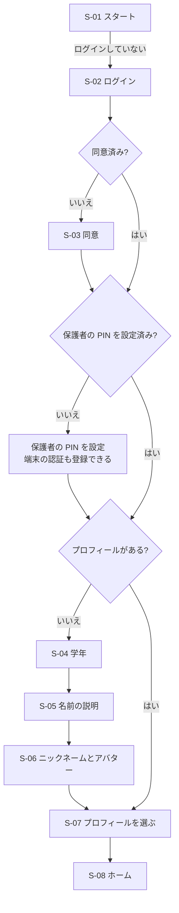

# U1 機能設計：画面と流れ

U1 の範囲は、US-1.2（プロフィールを作る）、US-1.3（プロフィールを選んで始める）、US-7.2（使い方のルールを設定する）です。
ログイン（US-1.1、1.4〜1.6）は U8 で作るので、U1 では**開発用のログイン**（`DevAuthProvider`）で、画面の流れだけをつないでおきます。

## 1. 画面の一覧

| ID | 画面 | パス | 使う人 | 内容 |
|---|---|---|---|---|
| S-01 | スタート | `/` | 全員 | ログインしていなければ S-02 へ。プロフィールがなければ S-04 へ。あれば S-07 へ |
| S-02 | ログイン | `/login` | 保護者 | U1 では開発用（メールアドレスを入れるだけ）。U8 でマジックリンクとパスキーに置き換える |
| S-03 | 同意 | `/consent` | 保護者 | 同意事項（子ども向けの版と、保護者向けの詳しい版）。同意しないと先に進めない |
| S-04 | プロフィール作成：学年 | `/profiles/new` | 保護者と子ども | 学年を選ぶ（小1〜中3）。表示モードが自動で決まる |
| S-05 | プロフィール作成：名前の説明 | `/profiles/new/nickname-guide` | 保護者と子ども | 「本名をニックネームにしない」理由の説明（3コマ。`data-inventory.md` §3）。「わかった」を押すと次へ |
| S-06 | プロフィール作成：ニックネームとアバター | `/profiles/new/nickname` | 保護者と子ども | ニックネームの入力、アバターを選ぶ。本名らしいときは、やさしく確認する |
| S-07 | プロフィールを選ぶ | `/profiles` | 子ども | アイコンが並ぶ。タップで S-08 へ。PIN を設定したプロフィールは PIN を入れる。端の小さな「おうちのひと」ボタンから S-09 へ |
| S-08 | ホーム | `/home` | 子ども | U1 では空の状態（「ミスモンをよぶ」ボタンは、U3 ができるまで「じゅんびちゅう」と表示する） |
| S-09 | 保護者の確認 | `/parent/unlock` | 保護者 | 保護者の PIN、または端末の認証（指紋・顔など。WebAuthn）。成功したら S-10 へ |
| S-10 | 保護者メニュー | `/parent` | 保護者 | プロフィールの追加・編集・削除、使い方のルール、データの書き出し・削除 |
| S-11 | 使い方のルール | `/parent/rules` | 保護者 | 1日に登録できる間違いの数、使える時間帯、通知のオン・オフ |
| S-12 | データの管理 | `/parent/data` | 保護者 | 書き出し（JSON）、子どもごとの削除、全部の削除 |

## 2. 初めて使うときの流れ

保護者の PIN は、同意の直後に必ず設定してもらいます。子どもが保護者メニューに入れないようにするためです（US-7.2）。

## 3. 表示モードごとの違い

| | 低学年（lower） | 高学年（upper） | 中学生（junior） |
|---|---|---|---|
| 対象の学年（初期値） | 小1〜小2 | 小3〜小6 | 中1〜中3 |
| 文字 | ひらがなが中心。漢字にはふりがな | その学年までに習う漢字を使い、まだ習っていない漢字にはふりがな | 普通の表記 |
| 読み上げ | 画面の説明文に読み上げボタン | ボタンで読み上げ | なし（設定でオンにできる） |
| ボタン | 大きい（最小 56px） | 普通（最小 48px） | 普通（最小 44px） |
| 見た目 | カラフル、キャラクターが大きい | カラフル | 落ち着いた色、キャラクターは控えめ（US-5.6） |

- 「まだ習っていない漢字にふりがな」は、文部科学省の「学年別漢字配当表」を使って判定します（データは `content/` に置く）。
- 表示モードは学年で自動的に決まりますが、保護者メニューから手で変えられます。

## 4. 部品（主なもの）

| 部品 | 内容 |
|---|---|
| `AppShell` | 表示モードに合わせたテーマ、「視差効果を減らす」設定への対応、オフラインの表示 |
| `Ruby` | ふりがな。表示モードと漢字配当表から、自動で付ける |
| `ReadAloud` | 読み上げ（ブラウザの音声合成。Web Speech API） |
| `ProfileTile` | プロフィールを選ぶ画面のアイコン |
| `AvatarPicker` | プリセットのアバターを選ぶ（写真のアップロードはなし） |
| `NicknameGuide` | 名前の説明の3コマ |
| `PinPad` | PIN の入力（保護者用は6桁、子どもの任意の PIN は4桁） |
| `GradePicker` | 学年を選ぶ（小1〜中3。Phase 2 で高1〜高3を足す） |
