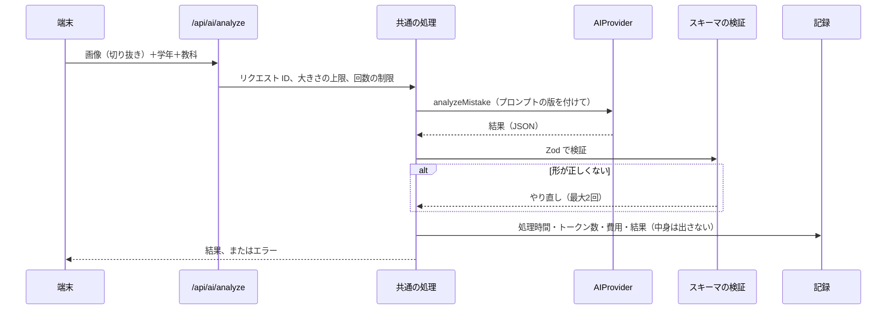

# U2 機能設計：AI の基盤

U2 では、AI とやりとりする土台を作ります。ミスモンやバトルの画面は、まだ作りません（U3〜U5）。

## 1. 作るもの

| # | 作るもの | 内容 |
|---|---|---|
| 1 | `AIProvider` のインターフェース | `inception/application-design/ai-provider.md` のとおり。U2 では、解析（`analyzeMistake`）、問題の生成（`generateCounterProblems`）、検証役（`solve`）、短い文の採点（`gradeFreeText`）の4つを作る。傾向の要約（`summarizeTrends`）は U7 で作る |
| 2 | `MockProvider` | 決まった答えを返す、開発・テスト用の AI。`fixtures/` の答えを返す。キーなしで全機能が動く |
| 3 | `BedrockProvider` | Amazon Bedrock の Claude につなぐ。Converse API を使い、画像を渡し、出力は「ツールの呼び出し」の形で JSON にして受け取る |
| 4 | プロンプトの管理 | プロンプトを、版の番号を付けてファイルで管理する（`server/ai/prompts/`）。どの版で答えたかを、すべての結果に記録する |
| 5 | API の共通の処理 | `/api/ai/*` の Route Handler で共通に使う、リクエスト ID、入力の大きさの上限、回数の制限、時間切れ、エラーの形 |
| 6 | 記録（テレメトリ） | 処理時間、トークン数、おおよその費用、結果（成功・失敗）を、構造化したログに出す。**画像と、問題文などの中身は出さない** |
| 7 | 評価（eval）の仕組み | `evals/` のサンプルで、AI の精度と費用を測るコマンドと、結果のレポート |
| 8 | つながり先の確認 | `/api/health/ready` と起動時のログに、つながっている AI のプロバイダー、AWS のアカウント（末尾4桁）、リージョン、モデルを出す |

## 2. 処理の流れ（解析の例）

## 3. AWS のアカウントの切り替え（社用・個人用）

2026-11-08 の確認：会社に所属している間は社用のアカウント、そのあとは個人用のアカウントを使う。

- **アカウントに依存しない**：アカウント ID、リージョン、モデル ID、推論プロファイルは、すべて環境変数で決める。コードに書かない。
- **切り替えは AWS のプロファイル**：`AWS_PROFILE=company` / `AWS_PROFILE=personal`。認証情報は、開発者の PC の AWS の設定（`~/.aws/config`。できれば SSO）に置き、リポジトリにも `.env` にも書かない。
- **設定の例を2つ用意する**：`.env.company.example` と `.env.personal.example`（秘密の値は入れない）。`pnpm dev` の前に、どちらかを `.env.local` にコピーする。
- **取り違えを防ぐ**：起動時のログと `/api/health/ready` に、つながっているアカウントの末尾4桁・リージョン・モデルを出す（AWS STS の GetCallerIdentity を使う）。
- **移しやすさ**：新しいアカウントでやることを、手順書（`docs/aws-account-setup.md`）にまとめる。Bedrock でモデルを使う許可の申請、IAM の権限、リージョン。

## 4. AI の結果の扱い

- 結果は、必ず Zod のスキーマで検証する。形が正しくなければ、同じリクエストをやり直す（最大2回）。それでもだめならエラーにする。
- 結果には、`provider`、`model`、`promptVersion`、`requestId` を付ける（報告や評価で、どの条件で出た答えかを追えるように）。
- 画像の中の文字は「データ」として扱い、指示として実行させない（システムプロンプトで明示する。NFR-X2）。
