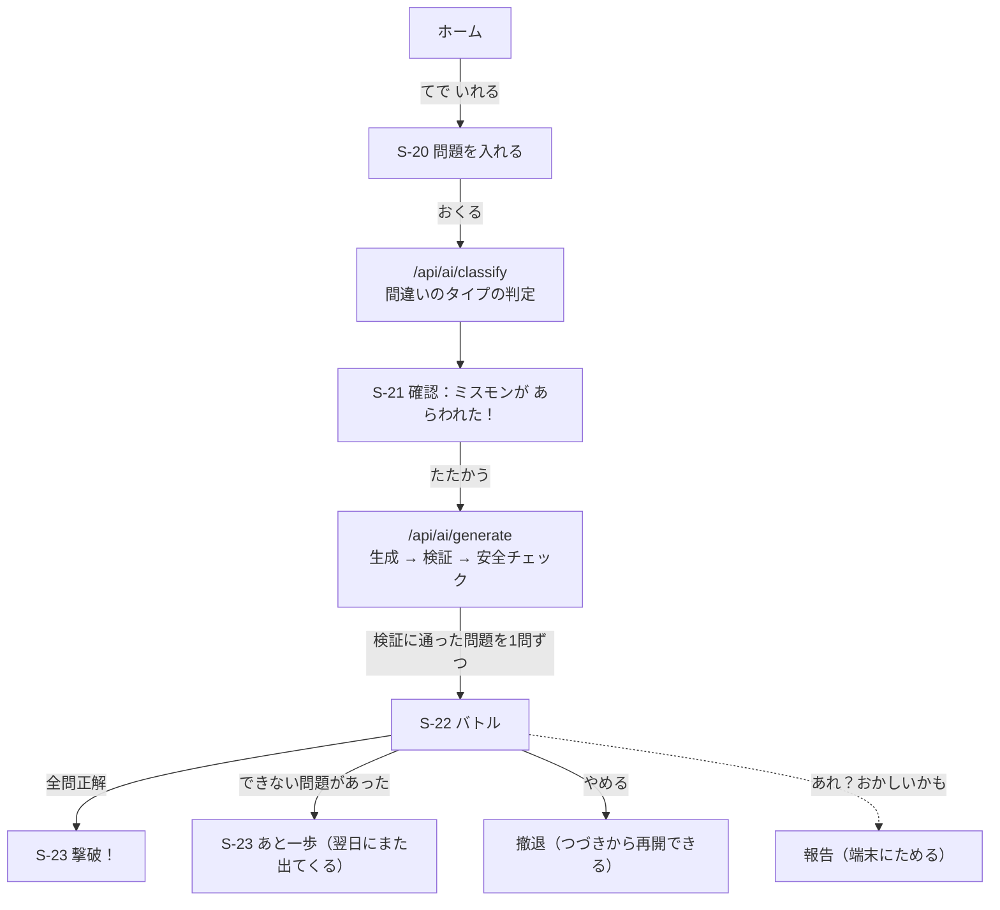

# U4・U5 機能設計：問題の生成と検証、バトル

U4（問題の生成と検証）と U5（バトル・採点）は、一緒に作ります。偽物の AI で、次の流れが端から端まで動くようにします。

> 間違えた問題を手で入れる → AI が間違いのタイプを判定する → ミスモンが現れる → 専用の問題（かえりうち問題）で戦う → 撃破

## 1. 流れ

## 2. 画面

| ID | 画面 | 内容 |
|---|---|---|
| S-20 | 問題を入れる | 教科（ボタン）、問題文、きみの答え、正しい答え。子どもが自分で使える（ホームの「てで いれる」）。低学年は保護者が横で手伝う前提で、入力欄は少なく短くする |
| S-21 | ミスモンが あらわれた！ | AI が判定した間違いのタイプと、ミスモン（仮の SVG）。判定が違えば、タイプを選び直せる |
| S-22 | バトル | ミスモンと HP のバー、問題、答え方ごとの入力、ヒント、「もんだいが おかしい？」 |
| S-23 | 結果 | 撃破・あと一歩。間違えた問題の解説をもう一度見られる |

写真の解析（U3）ができたら、S-20 の代わりに撮影の画面から S-21 に進みます。S-20 は「読み取れなかったときに手で入れる」ために残します（US-3.2）。

## 3. 間違いのタイプの判定（手で入れたとき）

- 新しい API `/api/ai/classify`：問題文・子どもの答え・正しい答え・教科・学年を受け取り、`MistakeAnalysis` を返す（画像なし）。
- AI のプロバイダーに `classifyMistake` を足す（偽物の AI と Bedrock の両方）。
- 正しい答えは、子どもが入れたものを使う（AI に正しい答えを推測させない）。

## 4. 問題の生成と検証（U4）

`/api/ai/generate` の中で、次の順に処理します。

1. AI が問題を作る（初回3問・再来2問）
2. 1問ずつ検証する
   - **算数・数学の数値の問題**：数式を計算して、答えが合っているかを確かめる（検算）
   - **選択式**：検証役の AI が、選択肢のどれが正解かを独自に答え、それが1つだけで、作った側の答えと一致するかを確かめる
   - **それ以外**：検証役の AI が独自に解き、答えを比べる（表記の揺れは吸収する）
3. 安全のチェック（不適切な言葉、個人情報らしい文字）
4. 通った問題だけを、1問ずつ端末に送る（作りながら届ける。1問目は10秒以内を目指す）
5. 足りなければ1回だけ作り直す。それでも、通った問題が2問以上あればその数で戦う。1問以下なら「うまく つくれなかった」と出し、あとでもう一度試せるようにする。**検証していない問題は、絶対に出さない**

検証の結果（どの方法で、何回作り直したか）は、問題ごとに記録します（`Problem.verification`）。

## 5. バトル（U5）

- 1問につき3回まで挑戦できる。1回間違えたらヒント1、2回間違えたらヒント2、3回間違えたら答えと解説を見せて次へ（その問題はダメージなし）。
- 正解するとダメージ。全問正解で**撃破**、1問でもできなければ**あと一歩**（翌日にまた出てくる）。負けても罰はない。
- 途中でやめても、次は続きから再開できる。
- 採点は、できるだけ端末でルールどおりに行う。短い文の答えで、ルールで判断できないときだけ `/api/ai/grade` を使う。

## 6. 報告（もんだいが おかしい？）

- すべての問題と解説の画面から報告できる（FR-5.6）。
- U8 ができるまでは、報告を**端末に保存し、送信待ち（outbox）に入れておく**。U8 で同期ができたら、サーバーに届く。
- それまでは、保護者メニューで報告の一覧を見られるようにする（開発中は、あなたがここで確かめる）。
- ボタンは「あれ？おかしいかも」。理由の一番上は「あってるのに ×に なった」。そのときは、その場では正解として扱って次へ進む（1回のバトルで1問まで）。詳しくは BR-45-8。

## 7. このユニットで作らないもの

- XP、レベル、図鑑、連続記録、再来の日程（U6）。U5 では、バトルの結果（撃破・あと一歩）と、再来のための記録だけを残す
- 写真の撮影と解析（U3）
