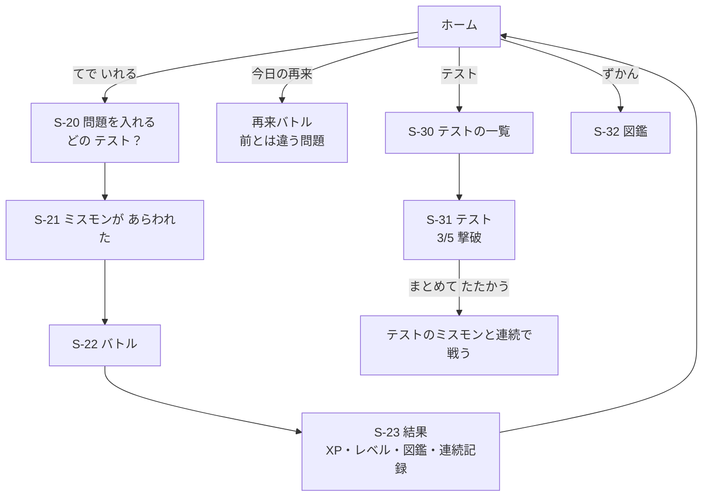

# U6 機能設計：ゲーミフィケーション・再来

U5 までで「間違いを入れる → ミスモン → かえりうち問題 → 撃破」が動きます。U6 では、**続けたくなる仕組み**と、**忘れかけたころにもう一度戦う仕組み**を足します。偽物の AI で、外の準備を待たずに作ります。

## 1. 流れ

## 2. 画面

| ID | 画面 | 内容 |
|---|---|---|
| S-08 | ホーム（変更） | レベルと XP のバー、連続記録、今日の再来ミスモン（数と一覧）、「テスト」「ずかん」への入り口 |
| S-20 | 問題を入れる（変更） | 「どの テスト？」を足す。初めは「あたらしい テスト」。続けて入れるときは、同じテストを選べる |
| S-23 | 結果（変更） | もらった XP の内訳、レベルアップ、図鑑の登録・銀・金、連続記録 |
| S-30 | テストの一覧 | 名前、教科、日付、撃破の進み具合（3/5）、クリア |
| S-31 | テスト | そのテストのミスモンの一覧、「まとめて たたかう」、名前を変える |
| S-32 | 図鑑 | 間違いのタイプごとのカード（まだ・銅・銀・金）。中学生モードでは「弱点ノート」 |

## 3. テスト（まとまり）

- 手で入れるときに、テストを選ぶ（2026-11-11 に決定）。U3 で写真から入れたものも、同じ「テスト」になる。
- 名前は教科と日付から自動で付ける（例：「さんすう 11/11 の テスト」）。あとから変えられる（30字まで）。
- 「まとめて たたかう」：そのテストの、まだ倒していないミスモン（新しいもの・あと一歩・今日の再来）と、順番に戦う。1匹ごとに結果を出し、次へ進む。途中でやめても、次は続きから。
- そのテストのミスモンを全部1回以上撃破したら「クリア」。

## 4. 再来

- 撃破したミスモンは、1日後、3日後、7日後、14日後、30日後に再来する（FR-7.1）。
- 再来では、前に出した問題とは違う問題を2問作る（BR-45-3）。
- 再来で「あと一歩」なら、間隔を最初（1日後）に戻す（FR-7.3）。
- 30日後の再来を撃破したら「完全撃破」。その後は出てこない。
- ホームに「今日の再来ミスモン」の数と一覧を出す。日付は端末の午前0時で区切る。
- 再来の問題は、戦うときに作る（通信が必要）。前もって作っておく仕組み（US-6.3、オフラインでの再来）は MVP に入れない。

## 5. XP・レベル・図鑑・連続記録

- 計算はすべて純粋な関数にし、記録（バトルの結果）から計算し直せるようにする（U8 で、2つの端末の記録をまとめても食い違わないように）。
- 数字は設定ファイル（`content/game/rules.json`）に置き、β版で変えられるようにする。
- 中学生モードでは、見た目と言葉を落ち着かせ、図鑑を「弱点ノート」として見せる（2026-11-11 に決定）。

## 6. ふりがな（Issue #14）

- 問題を作るときに、AI に「漢字の語とその読み」の一覧も返させる（2026-11-11 に決定）。
- サーバーで、読みがひらがなだけか、その語が本当に文の中にあるかを確かめる。おかしいものには付けない。
- 画面では、U1 と同じ基準（その学年までに習っていない漢字を含む語）で付ける。
- 「あれ？おかしいかも」の理由に「よみがなが へん」を足す。

## 7. このユニットで作らないもの

- ボス戦（US-5.4）、きせかえとコイン（US-5.5）、オフラインでの再来（US-6.3）、教科・単元を選んでの復習（US-6.4）：MVP に入れない
- 再来のお知らせ（プッシュ通知）：U8 のあと
- 2つの端末の記録をまとめること：U8
