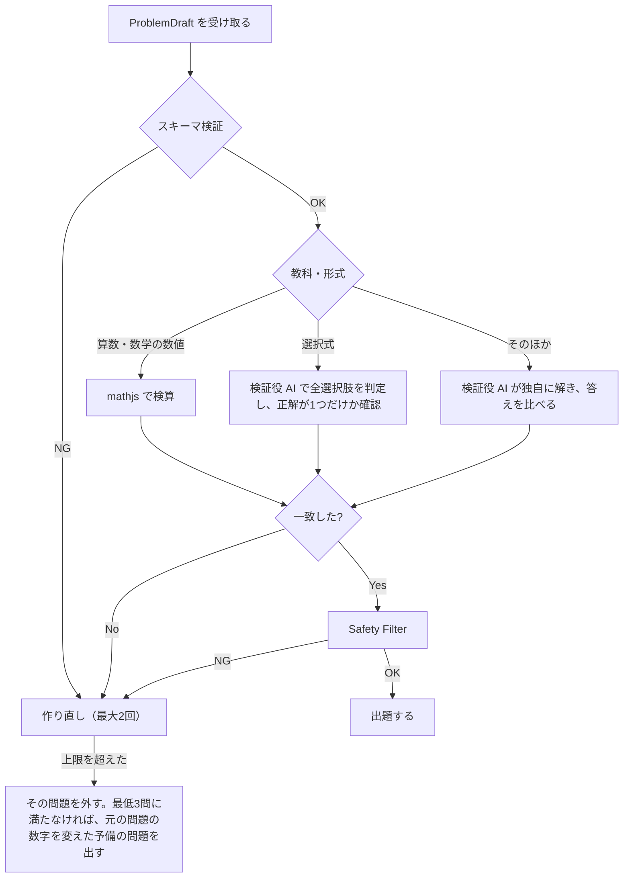

# アプリケーション設計：AIProvider と API

AI に関わる処理は、すべてこのインターフェースの後ろに隠します。最初に作って検証するのは **Amazon Bedrock（Claude）** のアダプターです（OQ5）。評価の結果によっては、ほかのプロバイダーに変えてもかまいません。

## 1. インターフェース

```ts
interface AIProvider {
  readonly name: string; // "mock" | "anthropic" | "bedrock" | ...

  /** 画像から間違いを解析する */
  analyzeMistake(input: {
    image: { mime: "image/jpeg" | "image/png"; data: Uint8Array };
    grade: Grade;
    subjectHint?: Subject;
    mistakeTypeCatalog: MistakeTypeSummary[]; // 当てはまりそうな候補だけを渡す
  }): Promise<MistakeAnalysis>;

  /** かえりうち問題を作る */
  generateCounterProblems(input: {
    analysis: MistakeAnalysis;
    grade: Grade;
    count: number;                 // 3〜5
    mode: "first" | "revisit" | "boss";
    avoid?: string[];              // 前に出した問題文（再来で同じ問題を出さないため）
  }): AsyncIterable<ProblemDraft>; // 1問ずつ返す

  /** 検証役として、問題を独自に解く（作った側の答えは渡さない） */
  solve(input: { problem: ProblemDraft; grade: Grade }): Promise<{ answer: string }>;

  /** 短い文の答えを採点する */
  gradeFreeText(input: {
    problem: Problem; answer: string; grade: Grade;
  }): Promise<{ correct: boolean; feedback: string }>;

  /** 保護者向けに、間違いの傾向を要約する */
  summarizeTrends(input: { stats: TrendStats; grade: Grade }): Promise<string>;
}
```

- 個々のプロバイダーの実装は `ProviderAdapter` として、「構造化した出力で呼ぶ」「画像を渡す」の2つの機能だけを作ればよい形にする。プロンプトを組み立てる処理は、プロバイダーに依存しない共通の部分（Prompt Registry）にまとめる。
- どのプロバイダーを使うかは、環境変数 `AI_PROVIDER` と、機能ごとの上書き（例：`AI_PROVIDER_VERIFY`）で決める。作る役と検証する役で、違うモデルを使えるようにする。
- **MockProvider** は、`fixtures/` にある決まった答えを返す。E2E テストと、キーなしでの開発に使う。

## 2. 出力のスキーマ（抜粋）

```ts
const MistakeAnalysis = z.object({
  subject: Subject,
  unit: z.string(),
  question: z.string(),
  childAnswer: z.string(),
  correctAnswer: z.string(),
  mistakeTypeId: z.string(),      // 候補一覧にないときは "other"
  explanation: z.string().max(200),
  confidence: z.object({
    question: z.number().min(0).max(1),
    childAnswer: z.number().min(0).max(1),
    correctAnswer: z.number().min(0).max(1),
  }),
  piiDetected: z.boolean(),       // 名前・学校名などが写っていたか
});
```

## 3. 問題を作る流れと検証



## 4. API

| メソッド・パス | 入力 | 出力 | 備考 |
|---|---|---|---|
| `POST /api/analyze` | 画像（multipart、2MB まで）、学年、教科（任意） | `MistakeAnalysis` | 画像はメモリ上だけで扱い、保存しない |
| `POST /api/generate` | `MistakeAnalysis`、学年、件数、モード、出題済みの問題文 | `Problem` を NDJSON でストリーミング | |
| `POST /api/grade` | `Problem`、答え、学年 | `{ correct, feedback }` | 短い文の答えだけ |
| `POST /api/summarize` | 集計値（個人を特定できる情報なし） | `{ summary }` | 保護者ダッシュボード用 |

共通：`Authorization: Bearer <端末トークン>`、`X-Request-Id`。端末ごと・プロフィールごとにレート制限をかける。

## 5. プロンプトインジェクションへの対策

- 画像の中の文字は「読み取る対象のデータ」であり、指示ではないことを、システムプロンプトで明示する。
- 出力は JSON スキーマに合ったものしか受け付けない。自由な文章の項目には、文字数の上限と Safety Filter をかける。
- AI に外部の操作（ツールの呼び出し）はさせない。

## 6. 評価（eval）

- `evals/` に、教科・学年ごとの正解つきサンプルを置く（画像と、期待する解析結果）。
- 評価する指標：解析が完全に一致した率、間違いのタイプの正解率、生成した問題が検証に合格した率、1回あたりのコスト、p90 の処理時間。
- プロンプトやプロバイダーを変える PR では、評価の結果を比べて載せることを必須にする。
