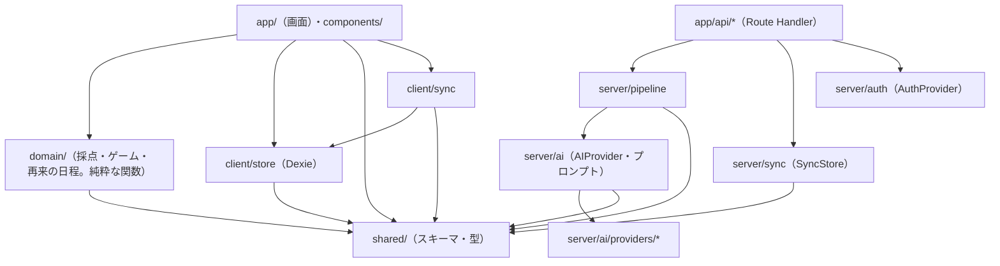

# アプリケーション設計：依存関係とディレクトリ構成

## 依存のルール

- `client` から `server` のコードは import しない。やりとりは `/api/*` と、共通のスキーマ（`shared/`）だけで行う。
- `shared/`（Zod スキーマとドメインの型）は、どこにも依存しない。
- ゲームのルール（C7）、再来の日程（C8）、採点（C6）は**純粋な関数**として作り、UI にも IndexedDB にも依存させない（単体テストのしやすさを優先する）。
- 外部のサービスの SDK（AWS、Anthropic、Supabase など）に依存してよいのは、`server/ai/providers/*`、`server/sync/stores/*`、`server/auth/providers/*` だけとする。



## ディレクトリ構成（案）

```
kaeriuchi/
├─ app/                    # Next.js App Router
│  ├─ (kid)/               # 子ども向けの画面: home, capture, confirm, battle, dex
│  ├─ (parent)/            # 保護者向けの画面: consent, profiles, dashboard, settings
│  └─ api/                 # analyze, generate, grade, summarize, sync, account, auth
├─ components/             # UI の部品（Monster、Keypad、CropBox など）
├─ client/
│  ├─ capture/             # カメラ、切り抜き、圧縮
│  ├─ store/               # Dexie のリポジトリ、データ構造の移行、送信待ちの一覧
│  ├─ sync/                # Sync Client
│  ├─ auth/                # マジックリンク、パスキー
│  └─ api-client/
├─ domain/
│  ├─ answer-checker/      # 答え方の形式ごとの採点ルール
│  ├─ battle/              # バトルの状態の管理
│  ├─ gamification/        # XP、図鑑、連続記録、ボス
│  └─ review/              # 再来の日程
├─ server/
│  ├─ pipeline/            # 解析 → 生成 → 検証の流れ
│  ├─ verifier/
│  ├─ safety/
│  ├─ ai/
│  │  ├─ provider.ts       # AIProvider インターフェース
│  │  ├─ prompts/          # プロンプトの雛形（バージョン管理する）
│  │  └─ providers/        # mock, bedrock, anthropic, ...
│  ├─ sync/
│  │  ├─ store.ts          # SyncStore インターフェース
│  │  └─ stores/           # memory, postgres, dynamo, ...
│  └─ auth/
│     ├─ provider.ts       # AuthProvider インターフェース
│     └─ providers/        # dev, authjs, cognito, supabase, ...
├─ shared/                 # Zod スキーマ、型、間違いのタイプの一覧
├─ content/
│  ├─ mistake-types/       # 教科ごとの間違いのタイプの一覧（YAML）
│  └─ monsters/            # 種族の定義と SVG
├─ evals/                  # 評価用のサンプルと評価スクリプト
├─ e2e/                    # Playwright
├─ docker-compose.yml      # ローカルの Postgres と、アプリを動かす
└─ aidlc-docs/
```
