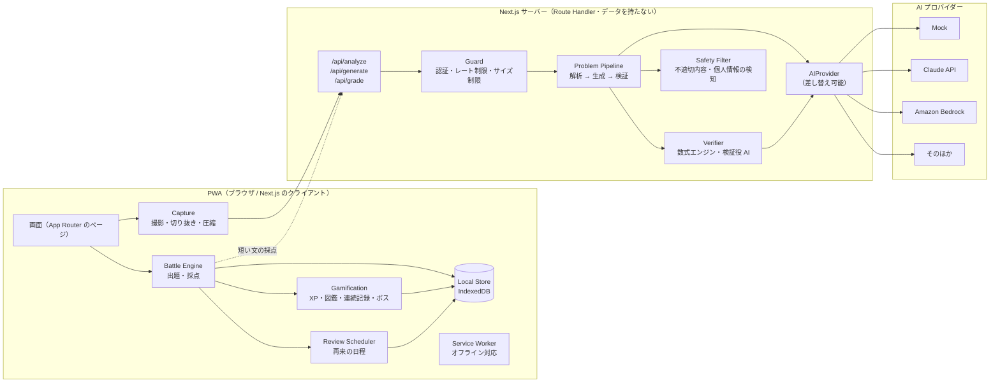
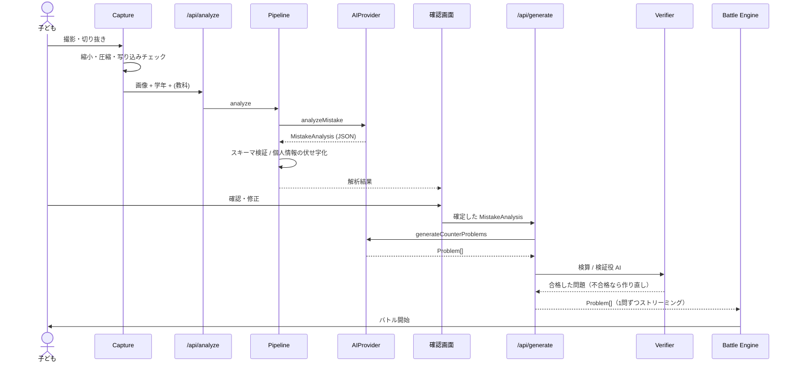

# アプリケーション設計：コンポーネント

## 1. 全体の構成

**設計の方針**

1. **ローカルファースト**：学習データ（ミスモン、問題、成績、ゲームの状態）は、すべて端末の IndexedDB に置く。サーバーは AI の中継と検証だけをして、データを持たない。
2. **AI は境界の外に置く**：AI に関わる処理は、すべてサーバーの `AIProvider` を通す。端末からは、プロバイダーに依存しない `/api/*` だけを呼ぶ。
3. **採点はできるだけ端末で、ルールどおりに**：AI に採点させるのは、短い文の答えでルールでは判断できないときだけ。
4. **AI の出力は信用しない**：すべてを JSON スキーマ（Zod）で検証し、正答も検算してから使う。

## 2. コンポーネント一覧

| # | コンポーネント | 置き場所 | 責務 |
|---|---|---|---|
| C1 | App Shell / UI | client | 画面、ルーティング、表示モード（低学年・高学年・中学生）、ふりがなと読み上げ |
| C2 | Profile & Consent | client | 保護者の同意、子どものプロフィール、保護者用 PIN |
| C3 | Capture | client | カメラ・写真の取り込み、切り抜き、向きの補正、縮小と JPEG 圧縮、名前などの写り込みの簡易チェック |
| C4 | API Client | client | `/api/*` の呼び出し、再試行、タイムアウト、ストリーミングの受け取り |
| C5 | Battle Engine | client | バトルの状態の管理、出題の順番、ヒントの出し方、HP の計算、途中からの再開 |
| C6 | Answer Checker | client | 答え方の形式ごとのルール採点（数値の正規化、同じ意味の答えの一覧、並べ替え） |
| C7 | Gamification | client | XP、レベル、図鑑、連続記録、ボスの出現、コイン |
| C8 | Review Scheduler | client | 再来の日程（決まった間隔）、今日の再来ミスモン、再来用の問題を前もって取りに行く |
| C9 | Local Store | client | IndexedDB（Dexie）のリポジトリ層、データ構造の移行、書き出しと削除 |
| C10 | Parent Dashboard | client | 集計、使い方のルール、傾向の要約（`/api/summarize`） |
| C11 | Service Worker | client | アプリ本体のキャッシュ、オフラインでのバトル |
| S1 | API Routes | server | `/api/analyze`, `/api/generate`, `/api/grade`, `/api/summarize` |
| S2 | Guard | server | 端末トークンの検証、レート制限、入力サイズの上限、リクエスト ID |
| S3 | Problem Pipeline | server | 解析 → 生成 → 検証 → 安全チェックの流れの制御、再試行、問題の入れ替え |
| S4 | Verifier | server | 数式の検算（mathjs）、選択肢の一意性、検証役 AI での答え合わせ |
| S5 | Safety Filter | server | 不適切な表現の検知、個人情報（名前・学校名など）の検知と伏せ字化 |
| S6 | AIProvider | server | プロバイダーの抽象化（`ai-provider.md`） |
| S7 | Prompt Registry | server | プロンプトの雛形とバージョン管理、教科ごとの指示 |
| S8 | Telemetry | server | 処理時間、トークン数、コスト、検証の失敗率（個人情報は送らない） |

## 3. 主な処理の流れ

### 3.1 撮影 → バトル開始

### 3.2 再来

1. Review Scheduler が、アプリの起動時とバックグラウンドの同期のときに「明日までに再来するミスモン」を探す。
2. それぞれについて `/api/generate`（`mode: "revisit"`）を呼び、前とは違う類題を作って IndexedDB に入れておく。
3. 再来の日になったら、オフラインでもバトルできる。

## 4. 技術スタック（案）

| 層 | 採用するもの | 理由 |
|---|---|---|
| フレームワーク | Next.js（App Router）+ TypeScript（strict） | 決定済み。画面とサーバー API を1つのリポジトリで作れる |
| UI | Tailwind CSS、Radix UI | アクセシビリティに配慮された部品があり、作るのが速い |
| アニメーション | Framer Motion（視差効果を減らす設定に対応） | バトルの演出に使う |
| 端末の保存 | IndexedDB（Dexie） | ローカルファースト。データ構造の移行もできる |
| スキーマ | Zod | AI の出力の検証、API の入出力の型を1か所で定義する |
| 数式 | mathjs、KaTeX | 検算と数式の表示 |
| PWA | Serwist（Workbox の後継） | Service Worker |
| テスト | Vitest、Testing Library、Playwright | 単体テスト、部品のテスト、E2E テスト |
| AI の評価 | 自前の評価スクリプト（Vitest で実行） | プロンプトの退行（品質が下がること）を確認する |
| ホスティング | Vercel、または AWS Amplify Hosting（OQ1, OQ5 と一緒に決める） | |
