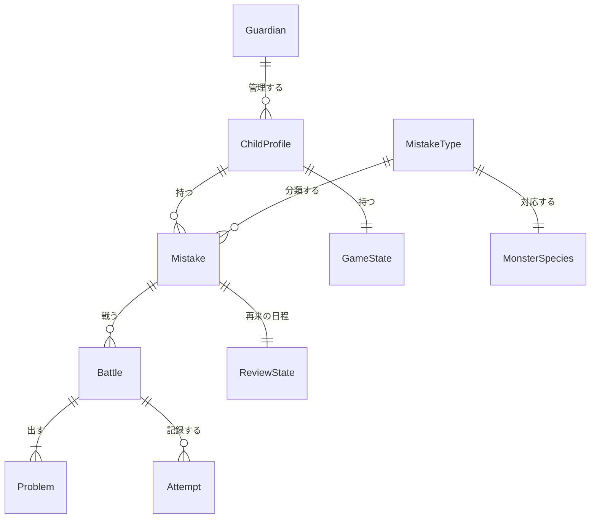

# アプリケーション設計：ドメインモデル

すべて TypeScript の型（実装では Zod スキーマから型を作る）で書きます。



## 主な型

```ts
type Subject = "math" | "japanese" | "english" | "science" | "social";
type Grade = "e1" | "e2" | "e3" | "e4" | "e5" | "e6" | "j1" | "j2" | "j3";
type DisplayMode = "lower" | "upper" | "junior"; // 低学年・高学年・中学生

/** 同期するデータすべてに付ける項目 */
interface SyncMeta {
  guardianId: string;         // 保護者ごとのデータの境界（テナント）
  updatedAt: string;          // 最後に更新した時刻（サーバーの時刻）
  version: number;            // 更新するたびに1つ増える
  deletedAt?: string;         // 削除の印（論理削除。決めた期間が過ぎたら、本当に消す）
}

interface Guardian {
  id: string;
  email: string;
  consentVersion: string;     // 同意した同意事項の版
  consentedAt: string;
  settings: { dailyCaptureLimit: number; allowedHours?: [string, string]; syncImages: boolean };
}

interface ChildProfile extends SyncMeta {
  id: string;
  nickname: string;
  grade: Grade;
  displayMode: DisplayMode;
  avatar: AvatarConfig;
  createdAt: string;
}

/** 撮影した1つの間違い = 1匹のミスモン */
interface Mistake extends SyncMeta {
  id: string;
  childId: string;
  subject: Subject;
  unit: string;               // 単元。例: "分数のたし算"
  question: string;           // 問題文（読み取ったものか、手で入力したもの）
  childAnswer: string;
  correctAnswer: string;
  mistakeTypeId: string;      // 例: "math.fraction.add-denominators"
  explanation: string;        // なぜ間違えたかの説明
  confidence: number;         // 0〜1
  editedByUser: boolean;
  thumbnail?: Blob;           // 端末内だけに保存する（同期しない。保護者が画像の同期をオンにしたときを除く）
  status: "active" | "defeated" | "mastered";
  createdAt: string;
}

/** 間違いのタイプの一覧（教科ごとに用意して管理する） */
interface MistakeType {
  id: string;                 // "教科.単元.タイプ" の形
  subject: Subject;
  label: string;              // 例: "分母どうしを足してしまう"
  grades: Grade[];
  speciesId: string;          // 対応するミスモンの種族
}

type AnswerFormat =
  | { kind: "numeric"; unit?: string; allowFraction?: boolean }
  | { kind: "choice"; options: string[] }
  | { kind: "text"; acceptable: string[] }   // 同じ意味の答えの一覧
  | { kind: "ordering"; tokens: string[] }
  | { kind: "self-check"; model: string };   // 漢字などを、お手本と見比べて自己採点する

interface Problem {
  id: string;
  role: "same-type" | "focus" | "stretch"; // 同型問題・ポイント問題・確認問題
  prompt: string;             // 問題文（数式は KaTeX の記法で書ける）
  ruby?: Record<string, string>; // ふりがな
  format: AnswerFormat;
  answer: string;             // 正しい答え（正規化したもの）
  hints: [string, string?];
  explanation: string;
  verification: {
    method: "math-engine" | "choice-uniqueness" | "cross-check";
    passed: true;
  };
}

interface Battle {
  id: string;
  mistakeId: string;
  kind: "first" | "revisit" | "boss";
  problems: Problem[];
  monsterHp: number;
  currentIndex: number;
  result?: "defeated" | "almost" | "retreated"; // 撃破・あと一歩・撤退
  startedAt: string;
  finishedAt?: string;
}

interface Attempt {
  battleId: string;
  problemId: string;
  answer: string;
  correct: boolean;
  hintsUsed: number;
  gradedBy: "rule" | "ai" | "self";
  elapsedMs: number;
}

/** 再来の日程の状態 */
interface ReviewState {
  mistakeId: string;
  stage: number;              // 0〜5。間隔は 1, 3, 7, 14, 30 日
  dueAt: string;
  prefetchedBattleId?: string;
}

interface GameState {
  childId: string;
  xp: number;
  level: number;
  coins: number;
  streak: { current: number; best: number; lastDate: string; freezeTickets: number };
  dex: Record<string, "seen" | "defeated" | "gold">; // 種族ID → 図鑑の状態
}
```

## 計算ルール（初期値。Functional Design で調整する）

| 項目 | ルール |
|---|---|
| ミスモンの HP | 問題数 × 100 |
| ダメージ | 正解で 100。ヒントを1つ使うごとに −30（最低 40） |
| もらえる XP | 撃破で +50、ヒントなしで全問正解なら +30、再来の撃破で +40、ボスの撃破で +150 |
| 再来の間隔 | 1日 → 3日 → 7日 → 14日 → 30日。5回目の撃破で「完全撃破」（`mastered`） |
| 再来で負けたとき | 間隔を最初の段階（0）に戻す |
| ボスの出現 | 同じ単元で `active` か `defeated` のミスモンが5匹以上になったら出る |

## 同期のまとめ方（複数の端末で変更したとき）

| データ | ルール | 理由 |
|---|---|---|
| `Attempt`、`Battle` の結果 | 追記だけ（同じ ID は1回だけ反映する） | 記録は消えてはいけない |
| `GameState.xp`、`coins` | 保存するのは「増えた量・減った量」の出来事にして、合計はそこから計算する | 2つの端末で同時にもらった XP が、両方とも残る |
| `GameState.dex` | 状態の強い方を採用する（`gold` > `defeated` > `seen`） | 図鑑の登録は戻らない |
| `GameState.streak` | `Attempt` の日付から計算し直す | 出来事から計算すれば、食い違いが起きない |
| `ReviewState` | `Attempt` から計算し直す（再来の結果の順番どおりに当てはめる） | 同じ |
| `ChildProfile`、`Mistake` の編集、`Guardian.settings` | 最後に更新したものを採用する（`updatedAt` で比べる） | 同時に編集することがほとんどない |
| 削除 | 削除の印（`deletedAt`）を優先する | 消したものが復活しないようにする |

**ポイント**：成績やゲームの状態は「出来事の記録（`Attempt` など）」から計算できるようにしておき、同期では出来事の記録だけを確実に送ります。こうすると、食い違いをまとめる処理が単純になります。
