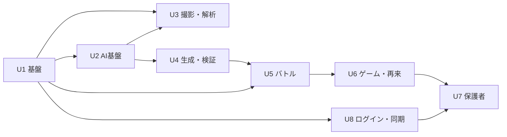

# 実行計画（Workflow Planning）

## 1. 進める順番

| 段階 | ユニット | ねらい |
|---|---|---|
| Sprint 1 | U1、U2 | 土台。MockProvider で端から端まで流れる骨組みを作る |
| Sprint 2 | U4、U5（並行して進める） | 一番の価値である「専用問題で返り討ちにする」体験を、モックで完成させる |
| Sprint 3 の前半 | 課題 R1 のスパイク | 写り込みへの対策の方法を検証して決める（`open-questions.md` の R1） |
| Sprint 3 | U3、U8（並行して進める） | 実際の撮影と本番の AI（Bedrock）につなぐ。評価で精度を測る。ログインとクラウド同期を作り、本番の基盤を決める |
| Sprint 4 | U6、U7 | 続けて使いたくなる仕組みと、保護者向けの機能。β版のテストを始める |

**U8 を Sprint 3 にする理由**：U1 で「送信待ち」を記録する仕組みと、出来事の記録から状態を計算する形を先に作っておけば、同期は後から足せます。U4・U5 で扱うデータの形が固まってから、同期のまとめ方のルールを決めた方が、作り直しが少なくなります。

**U3 を後にする理由**：撮影と解析は、AI の精度による不確実さが一番大きい部分です。先に U4 と U5 をモックで作っておき、手で入力したものから始まる流れで価値を確かめられるようにします。こうすると、AI の検証と UI の開発が互いを待たずに進められます。

## 2. ユニットごとに行うステージ

| ステージ | U1 | U2 | U3 | U4 | U5 | U6 | U7 | U8 |
|---|---|---|---|---|---|---|---|---|
| Functional Design | 簡易 | ✅ | ✅ | ✅ | ✅ | ✅ | 簡易 | ✅（まとめ方のルール） |
| NFR Requirements / Design | ✅（PWA・移しやすさ） | ✅（コスト・処理時間） | ✅（プライバシー） | ✅（品質） | 簡易 | 簡易 | 簡易 | ✅（プライバシー・データの境界・削除） |
| Infrastructure Design | ✅（CI・Docker） | ✅（Bedrock の権限・秘密情報の管理・レート制限） | — | — | — | — | — | ✅（ホスティング・保存先・ログインの基盤を比べて決める） |
| Code Generation | ✅ | ✅ | ✅ | ✅ | ✅ | ✅ | ✅ | ✅ |
| Build & Test | ✅ | ✅ + 評価 | ✅ + 評価 + 実機 | ✅ + 評価 | ✅ + E2E | ✅ | ✅ | ✅ + 複数端末のテスト |

## 3. 主なリスクと対策

| リスク | 影響 | 対策 |
|---|---|---|
| 手書きの答えや赤ペンを正しく読み取れない | 体験の入り口で失敗する | 確認画面で必ず直せるようにする。信頼度が低いときは確認を必須にする。手で入力する方法も用意する。評価で教科ごとの精度を測り、精度の低い教科は「β」と表示する |
| 生成した問題の正答が間違っている | 子どもに誤ったことを教えてしまう（致命的） | 検算と検証役 AI での二重の確認。報告ボタン（MVP に必須）。誤りの率は評価用データとβ版で実測し、その結果で目標の値と、教科ごとに出すかどうかを決める。2つの AI が同じように間違えることはあるので、報告からの改善のループを止めないことが大切 |
| 丸付けしていない宿題が多い（課題 R2） | AI が自分で採点することになり、解析を誤るリスクが上がる | 両方を扱える設計にしておき、β版で実際の割合を測ってから決める |
| AI のコストがかさむ | 赤字になる | 撮影回数の上限。解析と生成で違うモデルを使う。再来用の問題を前もって作り、結果を再利用する |
| 本名・学校名などが写った写真が送られる（課題 R1） | 子どもの個人情報が AI プロバイダーに渡る | U3 の前にスパイクで方法を検証する。それまでは、切り抜きは必須、画像は保存しない、ログに出さない、を守る |
| 子どもの個人情報を扱うことへの不安 | 保護者が使ってくれない | 切り抜いた部分だけを送る。画像はクラウドに残さない。クラウドに置くのは最小限の文字の情報だけにする。同意画面でわかりやすく説明する |
| クラウドに子どものデータを持つ（OQ1） | 情報が漏れたときの影響が大きい | 国内のリージョンに置く。暗号化する。保護者ごとのデータの境界を、アプリと DB（RLS）の両方で守る。データを見たときのログを残す。退会したら削除する。リリース前にセキュリティレビューを行う |
| 複数の端末での同期の食い違い | XP や記録が消えて、子どもががっかりする | 出来事の記録から状態を計算する設計にする。データの種類ごとのまとめ方のルールを決める。複数端末のシナリオを自動テストする |
| 基盤を固定しないことで、実装が抽象的になりすぎる | 開発が遅くなる | インターフェースは、いま必要な操作だけにとどめる。本番の実装は1つずつ足していく |
| ゲームの要素が強すぎて、勉強より遊びが中心になる | 学習の効果が下がる | 報酬は「直したこと」にだけ与える。課金と連動させない。使える時間を保護者が設定できる |
| iOS Safari の PWA の制約（カメラ、プッシュ通知、保存容量） | 一部の機能が使えない | U1 と U3 の早い段階で実機を確認する。保存容量の上限を超えたら、古いサムネイルを削除する |

## 4. 次のステップ

1. ~~未決事項 OQ1〜OQ7 に回答する~~ → 2026-11-08 に回答済み。
2. 扱うデータの一覧（`requirements/data-inventory.md`）を確定 → 2026-11-08 に議論して確定。
3. このドキュメント一式の最終レビュー。
4. 承認されたら、Construction フェーズを **U1 の Functional Design** から始める。
