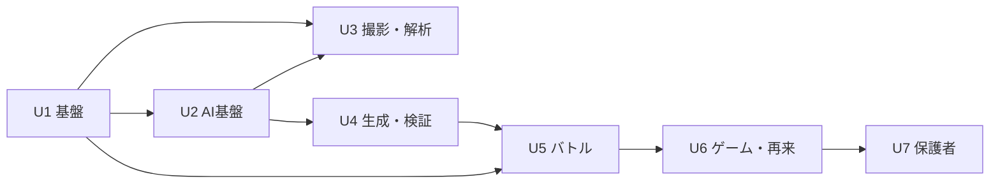

# 実行計画（Workflow Planning）

## 1. 進める順番

| 段階 | ユニット | ねらい |
|---|---|---|
| Sprint 1 | U1、U2 | 土台。MockProvider で端から端まで流れる骨組みを作る |
| Sprint 2 | U4、U5（並行して進める） | 一番の価値である「専用問題で返り討ちにする」体験を、モックで完成させる |
| Sprint 3 | U3 | 実際の撮影と本番の AI につなぐ。評価で精度を測る |
| Sprint 4 | U6、U7 | 続けて使いたくなる仕組みと、保護者向けの機能。β版のテストを始める |

**U3 を後にする理由**：撮影と解析は、AI の精度による不確実さが一番大きい部分です。先に U4 と U5 をモックで作っておき、手で入力したものから始まる流れで価値を確かめられるようにします。こうすると、AI の検証と UI の開発が互いを待たずに進められます。

## 2. ユニットごとに行うステージ

| ステージ | U1 | U2 | U3 | U4 | U5 | U6 | U7 |
|---|---|---|---|---|---|---|---|
| Functional Design | 簡易 | ✅ | ✅ | ✅ | ✅ | ✅ | 簡易 |
| NFR Requirements / Design | ✅（PWA・プライバシー） | ✅（コスト・処理時間） | ✅（プライバシー） | ✅（品質） | 簡易 | 簡易 | 簡易 |
| Infrastructure Design | ✅（ホスティング・CI） | ✅（秘密情報の管理・レート制限） | — | — | — | — | — |
| Code Generation | ✅ | ✅ | ✅ | ✅ | ✅ | ✅ | ✅ |
| Build & Test | ✅ | ✅ + 評価 | ✅ + 評価 + 実機 | ✅ + 評価 | ✅ + E2E | ✅ | ✅ |

## 3. 主なリスクと対策

| リスク | 影響 | 対策 |
|---|---|---|
| 手書きの答えや赤ペンを正しく読み取れない | 体験の入り口で失敗する | 確認画面で必ず直せるようにする。信頼度が低いときは確認を必須にする。手で入力する方法も用意する。評価で教科ごとの精度を測り、精度の低い教科は「β」と表示する |
| 生成した問題の正答が間違っている | 子どもに誤ったことを教えてしまう（致命的） | 検算と検証役 AI での二重の確認。報告ボタン。検証をすり抜けた誤りの率を KPI として追う |
| AI のコストがかさむ | 赤字になる | 撮影回数の上限。解析と生成で違うモデルを使う。再来用の問題を前もって作り、結果を再利用する |
| 子どもの個人情報を扱うことへの不安 | 保護者が使ってくれない | 切り抜いた部分だけを送る。サーバーに保存しない。ローカルファースト。同意画面でわかりやすく説明する |
| ゲームの要素が強すぎて、勉強より遊びが中心になる | 学習の効果が下がる | 報酬は「直したこと」にだけ与える。課金と連動させない。使える時間を保護者が設定できる |
| iOS Safari の PWA の制約（カメラ、プッシュ通知、保存容量） | 一部の機能が使えない | U1 と U3 の早い段階で実機を確認する。保存容量の上限を超えたら、古いサムネイルを削除する |

## 4. 次のステップ

1. このドキュメント一式をレビューする（PR のコメントで指摘してください）。
2. `requirements/open-questions.md` の OQ1〜OQ6 に回答する。
3. 承認されたら、Construction フェーズを **U1 の Functional Design** から始める。
